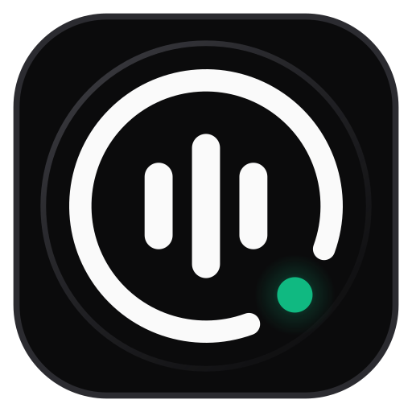

<p align="center">
  
</p>

<h1 align="center">Shizuka</h1>

<p align="center">
  <strong>Quiet the room. Keep your voice crystal clear.</strong><br />
  Local Real-Time AI Microphone Noise Cancellation (Windows / macOS) · MIT License
</p>

<p align="center">
  <a href="./README.md">日本語</a> | <strong>English</strong>
</p>

---

**Shizuka** is a lightweight, system-tray AI microphone noise cancellation app that removes keyboard typing, HVAC hum, and everyday room noise while delivering clear, natural speech to your voice chat and conferencing apps.  
All audio processing runs **100% locally on your device**—your voice is never uploaded to any external server—and the entire project is open-source under the **MIT License**.

## Downloads

Get the latest installers from **[GitHub Releases](https://github.com/naebox/shizuka/releases/latest)**.

| Platform | File | Description |
| --- | --- | --- |
| **Windows (64-bit)** | `Shizuka_*_x64-setup.exe` | **Recommended**: Standard NSIS installer (English & Japanese UI · In-app auto-updates) |
| **Windows (64-bit)** | `Shizuka_*_windows_x64_portable.zip` | Standalone portable ZIP (no installation required) |
| **Windows (64-bit)** | `Shizuka_*_x64_en-US.msi` | MSI installer package (supports in-app auto-updates) |
| **macOS (Apple Silicon)** | `Shizuka_*_aarch64.dmg` | For M1 and newer Macs (macOS 14+ · In-app auto-updates) |
| **macOS (Intel)** | `Shizuka_*_x64.dmg` | For Intel Macs (macOS 14+ · In-app auto-updates) |

> [!NOTE]
> Because official builds are personal unsigned binaries, your OS may show a one-time confirmation prompt on first launch:
> - **Windows**: If Windows SmartScreen appears, click **More info** → **Run anyway**.
> - **macOS**: On first launch, right-click the app icon and choose **Open** (or allow it via **System Settings → Privacy & Security → Open Anyway**).

## Key Features

- **Real-Time Neural Noise Cancellation (`DeepFilterNet3`)**
  - Separates human speech from keyboard clatter, fans, and ambient noise in real time at 48 kHz. Switch effortlessly between **High Accuracy** (maximum suppression clarity) and **Low Latency** (zero lookahead for live monitoring).
- **Speaker Call Echo Cancellation (`WebRTC AEC3`)**
  - Talking on speakers without headphones? Built-in `WebRTC AEC3` taps your speaker output (WASAPI Loopback on Windows, CoreAudio Process Tap on macOS 14.2+) so remote voices and system audio never echo back into your microphone.
- **Automatic Voice Isolation (`CAM++`)**
  - Just turn it on and speak naturally—Shizuka learns your voiceprint automatically in the background with zero manual enrollment phrases. Speech onsets pass through with zero clipping, while nearby family chatter or TV voices are muted automatically within ~0.3 seconds.
- **Auto-Mute Voice Gate (`VAD Noise Gate`)**
  - Neural SNR-driven voice activity gate with smooth hysteresis and hangover hold keeps word beginnings and soft endings intact while silencing typing and room noise completely when you stop speaking.
- **Voice Conditioning & Per-Microphone Profiles**
  - **Low-Cut Filter (65 Hz Butterworth HPF)**: Cuts desk vibrations, boom-arm thumps, and breath plosives while keeping natural vocal warmth intact.
  - **Auto Gain Control (VAD-Gated `AGC`)**: Levels your speaking volume smoothly only while you are talking (never pumps background noise during silence) and alerts you with a `CLIP` badge if input peaks hit the limiter.
  - **Per-Mic Memory**: Automatically saves and restores your tuning profile for each physical microphone you plug in.
- **Unobtrusive Background Operation & Global Shortcuts**
  - Lives quietly in the Windows system tray or macOS menu bar with customizable global hotkeys (plus optional subtle stereo chime feedback) for **Toggle Noise Cancellation** and **Toggle Mic Mute**.
  - Automatically recovers from USB mic disconnects and OS sleep/wake cycles, and continuously compensates for hardware clock drift (`AdaptiveOutputResampler` + PI `DriftController`) over multi-hour calls.
- **Built-In A/B Mic Test, One-Click Setup & Signed Auto-Updates**
  - Compare **Noise Cancelled** vs. **Raw Audio** live before joining a call, switch between **Dark / Light** themes and **English / Japanese** UI at any time, install the virtual microphone in one click, and update in place with Ed25519 signature verification.

---

## Using Shizuka with Discord, Zoom, Meet, or Teams

### Windows
1. Launch **Shizuka**, click **Install Virtual Mic Driver** in the setup banner, and click **Yes** on the UAC prompt (downloads and silently installs the official WHQL-signed `VB-CABLE` driver from `vb-audio.com`).
2. Once installed, Shizuka automatically routes its output to `CABLE Input` *(a one-time Windows restart is recommended after initial driver installation)*.
3. In your voice or meeting app's audio settings, select **`CABLE Output (VB-Audio Virtual Cable)`** as your Microphone.

### macOS
1. Grant Microphone access when prompted on first launch.
2. Click **Install Shizuka Virtual Mic (MIT)** in the setup banner and enter your Mac administrator password (installs the prebuilt Universal CoreAudio HAL plug-in—no Xcode tools or reboot required).
3. In your voice or meeting app's audio settings, select **`Shizuka Virtual Mic`** as your Microphone.
   - *Note: When enabling **Echo Cancellation** for speaker calls, macOS 14.2+ will prompt once for **System Audio Recording** permission.*

---

## Building from Source

Prerequisites: **Rust (stable)** and **Node.js (v20+)**  
*(Requires Visual Studio C++ Build Tools on Windows, or Xcode Command Line Tools `xcode-select --install` on macOS.)*

```bash
# Clone the repository
git clone https://github.com/naebox/shizuka.git
cd shizuka

# 1. Install frontend dependencies
npm install

# 2. Run in development mode
npm run tauri dev

# 3. Build production bundles (.exe / .msi / .app / .dmg)
npm run tauri build
```

## Changelog & Roadmap

See **[CHANGELOG.md](./CHANGELOG.md)** (bilingual Japanese / English) for release history and **[ROADMAP.md](./ROADMAP.md)** for the roadmap toward `v1.0.0`.

## License

[MIT License](./LICENSE)
