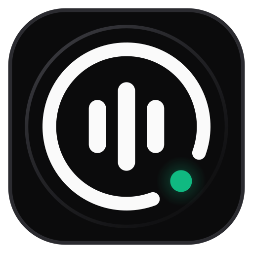

<p align="center">
  
</p>

<h1 align="center">Shizuka</h1>

<p align="center">
  ローカル完結・リアルタイム AI マイクノイズキャンセリングアプリ (Windows / macOS)<br />
  Powered by <strong>DeepFilterNet3</strong> + <strong>Neural VAD Gate</strong> · Rust / Tauri v2 · MIT License
</p>

---

**Shizuka（静か）** は、クラウド送信なしで動作するタスクトレイ常駐型のリアルタイム AI マイクノイズ除去アプリです。キーボード打鍵音・エアコン音・周囲の生活音を強力に抑えつつ、自然な声だけを仮想マイク経由で Discord / Zoom / Teams / Google Meet 等へ届けます。プロジェクト全体が **MIT ライセンス**（他社プロプライエタリ／GPL バイナリの同梱なし）で構成されています。

## 主な特徴

- **2 つの DeepFilterNet3 モデルをアプリ内で即時切替**
  - **高精度 `DeepFilterNet3`（既定・20ms 先読み）**: 未来 2 フレームを参照して突発的な打鍵音や環境音を高精度に分離
  - **超低遅延 `DeepFilterNet3_ll`（0ms 先読み）**: ライブモニター用途など極限の低遅延が欲しいときにワンクリックで切替
- **ニューラル `lsnr` 連動・無音時ノイズゲート（VAD）**
  - DeepFilterNet3 がフレームごとに推定する局所 SNR（`lsnr`）＋ 3.5 dB ヒステリシス＋ 180ms ホールド＋サンプル単位の滑らかなエンベロープにより、語尾や話し始めを切らずに非発話時の残留ノイズを完全ミュート
- **長時間通話でも音割れしないクロックドリフト補正**
  - 物理マイクと仮想オーディオデバイス間のクロック誤差を PI 制御＋非同期リサンプラー（`rubato`）で常時吸収
- **ゼロアロケーション＆OS リアルタイム優先度**
  - WASAPI (Windows) / CoreAudio (macOS) コールバックは完全ロックフリー（`ringbuf`）、推論スレッドは Windows MMCSS（`Pro Audio`）/ macOS Time-Constraint 優先度で動作
- **ミニマル UI（墨ダーク / 和紙ライト切替対応）＆ Discord 風リアルタイムマイクテスト**
  - 仮想マイク未導入でも、`▶` ワンクリック＋縦スリット音量バー・出力音量ゲージ・**「ノイズ除去 / 生音声」即時切替**で自分の声と除去効果を確認可能
- **ライセンスクリーンなワンクリック仮想マイク導入**
  - **Windows**: アプリ内に他社ドライバをバンドルせず、ボタン 1 つで公式 WHQL 署名済み VB-CABLE (Donationware by VB-Audio: https://vb-audio.com) を一時取得・UAC 昇格サイレント導入
  - **macOS**: スクラッチ実装の **MIT ライセンス CoreAudio HAL ループバックドライバ（`Shizuka Virtual Mic`）** を同梱しており、アプリ内ボタン（または `drivers/macos-hal/install_macos.sh`）から再起動不要で導入可能

---

## 会議アプリ（Discord / Zoom / Teams / Meet 等）との連携セットアップ

### Windows の場合
1. **Shizuka** を起動し、仮想マイク未導入の案内バナーにある **「仮想マイクドライバを自動インストール」** をクリックして管理者確認（UAC）で「はい」を選択します。
2. 導入完了後、出力先に `CABLE Input` が自動選択されます（※ 初回導入時のみ Windows の再起動が推奨されます）。
3. 会議アプリのマイク入力設定で **`CABLE Output (VB-Audio Virtual Cable)`** を選択します。

### macOS の場合
1. **Shizuka** を起動し、案内バナーの **「Shizuka Virtual Mic (MIT) を導入」** をクリックします（管理者パスワード入力後、`coreaudiod` が自動リロードされ即時認識されます。既存の `BlackHole 2ch` がある場合も自動対応します）。
2. 会議アプリのマイク入力設定で **`Shizuka Virtual Mic`** を選択します。
3. 初回起動時は「システム設定 → プライバシーとセキュリティ → マイク」で Shizuka にマイク権限を許可してください。

---

## 開発・ビルド手順 (Windows / macOS 共通)

必要環境: **Rust (stable)**, **Node.js (v20+)**
（※ Windows では Visual Studio C++ Build Tools、macOS では Xcode Command Line Tools `xcode-select --install`）

```bash
# リポジトリの取得
git clone https://github.com/seedling-nae/shizuka.git
cd shizuka

# 1. フロントエンド依存パッケージのインストール
npm install

# 2. 開発モードで起動
npm run tauri dev

# 3. リリース用ネイティブアプリのビルド (.exe / .msi / .app / .dmg)
npm run tauri build
```

## ライセンス
[MIT License](./LICENSE)
