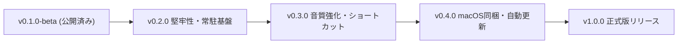

# Shizuka — 正式版 (`v1.0.0`) ロードマップ

`v0.1.0-beta` から `v1.0.0` 正式版までの段階リリース計画と進捗状況です。

## 基本方針

| 項目 | 方針 |
| :--- | :--- |
| **想定ユーザー** | 個人＋友人・身内向けの実用ツール（MIT ライセンス公開、日本語ファースト、シンプル重視、未署名ビルド前提） |
| **対応 OS** | **Windows / macOS を完全同等の正式サポート対象**とし、両 OS の実機検証を `v1.0.0` の必須条件にする |
| **リリース方式** | **段階リリース (`v0.2.0` → `v0.3.0` → `v0.4.0` → `v1.0.0`)** で日常利用と自動更新を検証しながら前進する |
| **UI 構成原則** | メイン画面は静かでシンプルな構成を維持し、一般設定は **右上の歯車アイコン → 設定モーダル (`<dialog>`)** に集約する |

---

## マイルストーン全体像

---

## Phase 1: `v0.2.0` — 毎日つけっぱなしにできる堅牢性・常駐基盤（リリース済み）

常用時の「無音停止」「二重起動」「毎回の手動起動」を解消し、設定モーダルの土台を整えます。

- [x] **USB 抜き差し・スリープ復帰の自動復旧** ([engine.rs](./src-tauri/src/audio/engine.rs), [devices.rs](./src-tauri/src/audio/devices.rs))
  - ストリームエラー通知＋フレーム無応答監視（Watchdog）で自動再接続。
  - 指定マイク切断時は別マイクへ勝手にフォールバックせず「再接続待ち」で待機し、復帰時に指数バックオフで自動再開。
  - 「システム既定のマイク (自動選択)」時は OS 既定マイク変更に自動追従。
- [x] **多重起動防止** ([lib.rs](./src-tauri/src/lib.rs), [Cargo.toml](./src-tauri/Cargo.toml))
  - `tauri-plugin-single-instance` により、2 つ目の起動時は既存ウィンドウを前面表示して即終了。
- [x] **OS 自動起動＆トレイ最小化常駐** ([lib.rs](./src-tauri/src/lib.rs), [tauri.conf.json](./src-tauri/tauri.conf.json))
  - `tauri-plugin-autostart`（`--minimized`）により、OS 起動時はウィンドウを出さずトレイ／メニューバーへ常駐。
- [x] **トレイ開閉トグル＆設定ファイルのアトミック保存** ([lib.rs](./src-tauri/src/lib.rs), [config.rs](./src-tauri/src/config.rs))
  - トレイ左クリックで表示 ↔ 非表示をトグル、`settings.json` は一時ファイル経由でアトミック保存。
- [x] **アプリ設定モーダル UI 基盤＆診断情報コピー** ([App.tsx](./src/App.tsx), [styles.css](./src/styles.css))
  - 右上の歯車アイコンから開く `<dialog>` モーダルに OS 自動起動・自動復旧カウンタ・診断コピーを集約。
- [x] `v0.2.0` リリース公開（macOS 実機フル検証は Phase 4 で最終確認）

---

## Phase 2: `v0.3.0` — 音質強化（HPF / AGC / マイク別記憶）＆グローバルショートカット（リリース済み）

音質の完成度と、フルスクリーンゲーム・会議中のハンズフリー操作を仕上げます。

- [x] **ハイパスフィルタ (HPF 約65Hz)** ([processor.rs](./src-tauri/src/audio/processor.rs))
  - ゼロアロケーション 2 次 Butterworth フィルタを AI 推論前に配置し、声の基音（85〜120Hz）を保ちつつ机の振動・アーム衝撃・吹かれ音を除去。
  - DeepFilterNet3 の不連続なステージスキップ（`20 dB` / `30 dB` 境界）および過剰なポストフィルタ・強制ゼロマスクを緩和し、高 SN 比マイクでの音量ジャンプ・機械音・途切れを解消。
- [x] **VAD 連動・軽量オートゲイン (AGC) ＋クリッピング警告** ([processor.rs](./src-tauri/src/audio/processor.rs), [App.tsx](./src/App.tsx))
  - `vad_speaking == true` の発話区間のみで追従するため、無音時の背景ノイズ持ち上げを防止。リミッター作動時にクリップ警告（`CLIP`）を表示。
- [x] **マイク別プロファイル自動記憶** ([config.rs](./src-tauri/src/config.rs), [lib.rs](./src-tauri/src/lib.rs))
  - 物理マイク名ごとにゲイン・除去強度・VAD・HPF・AGC 設定を自動保存・復元（UI 増加ゼロ）。
- [x] **グローバルショートカット＆マイクミュート** ([lib.rs](./src-tauri/src/lib.rs), [shortcuts.rs](./src-tauri/src/shortcuts.rs), [cue.rs](./src-tauri/src/audio/cue.rs))
  - `tauri-plugin-global-shortcut`（初期値未割当）で「ノイズ除去 ON/OFF」と「マイクミュート」を任意キー登録可能に。
  - ミュート専用トレイアイコン（`tray-mute.png`）＋控えめな合成操作音（設定で消音可）。
- [x] `v0.3.0` リリース公開（macOS 実機フル検証は Phase 4 で最終確認）

---

## Phase 3: `v0.4.0` — macOS ドライバ事前同梱＆ワンクリック自動アップデート（リリース済み）

配布・導入・最新化の摩擦をゼロにし、Windows / macOS 両方でワンクリック完結する体験を完成させます。

- [x] **macOS `ShizukaAudio.driver` の事前ビルド同梱（Xcode CLT 不要化）** ([build_driver.sh](./drivers/macos-hal/build_driver.sh), [release.yml](./.github/workflows/release.yml), [installer.rs](./src-tauri/src/installer.rs))
  - GitHub Actions の macOS ビルド時に Universal（`arm64` + `x86_64`）ドライバを事前コンパイルして Tauri リソース同梱（開発環境では `clang` フォールバックを維持）。
- [x] **アプリ内ワンクリック自動アップデート (`tauri-plugin-updater`)** ([updater.rs](./src-tauri/src/updater.rs), [lib.rs](./src-tauri/src/lib.rs), [release.yml](./.github/workflows/release.yml))
  - Ed25519 署名鍵＋`latest.json` 自動生成により、アプリ内からワンクリック更新（NSIS / MSI / macOS 対応、ポータブル版は Releases ページ誘導にフォールバック）。
- [x] **CI / リリース品質基盤の整備** ([ci.yml](./.github/workflows/ci.yml), [release.yml](./.github/workflows/release.yml))
  - `push` / PR 用の軽量検証 CI（`tsc`, `vite build`, Windows/macOS `cargo clippy --all-targets -- -D warnings`, `cargo test --lib`, macOS HAL ドライバビルド検証）、Node 24 アクション統一、`SHA256SUMS.txt` 自動添付。
- [x] **ステレオ和音操作音（「和の余白」A-5）＆設定 UI ブラッシュアップ** ([cue.rs](./src-tauri/src/audio/cue.rs), [App.tsx](./src/App.tsx))
  - 48 kHz ステレオ和音ブルーム＋極短リバーブによる上質なショートカット操作音へ刷新。
- [x] `v0.4.0` リリース公開（macOS 実機フル検証は Phase 4 で最終確認）

---

## Phase 4: `v1.0.0` — 正式版リリース（両 OS 実機検証・長時間耐久・仕上げ）

- [ ] **Windows 11 実機フル検証**: NSIS 導入、VB-CABLE 連携、USB 抜き差し＆スリープ復帰、自動起動、多重起動防止、HPF / AGC / マイク別設定、ホットキー＆操作音、アプリ内自動更新（`v0.4.0` → `v1.0.0`）
- [ ] **macOS 14+ 実機フル検証**: DMG 導入、事前同梱 `Shizuka Virtual Mic` ワンクリック導入（CLT なし）、マイク権限（[Info.plist](./src-tauri/Info.plist)）、メニューバー常駐・ダーク／ライト切替、ホットキー＆操作音、アプリ内自動更新
- [ ] **8 時間連続稼働耐久テスト**: Windows / macOS 両環境でメモリリーク・音途切れ・`drift_ppm` 発散がないことを確認
- [ ] **ドキュメント最終化**: [README.md](./README.md) の最終整備＆`v1.0.0` 正式リリース公開
